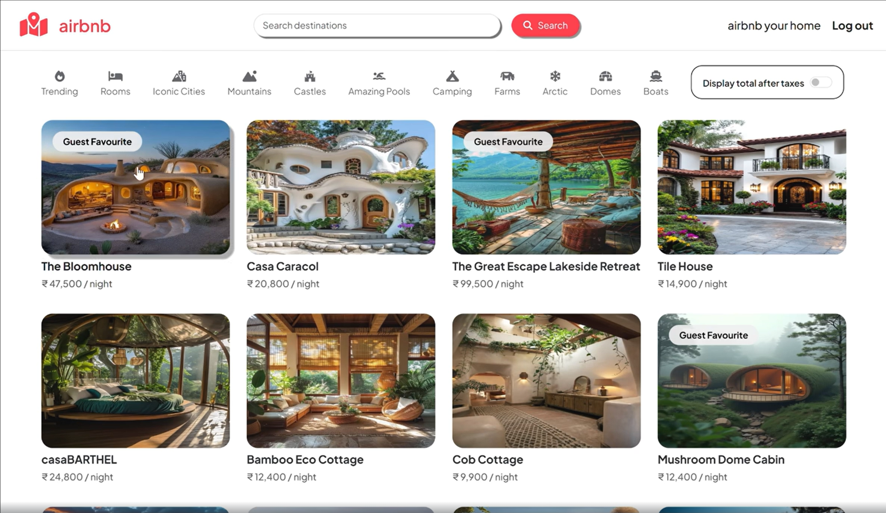
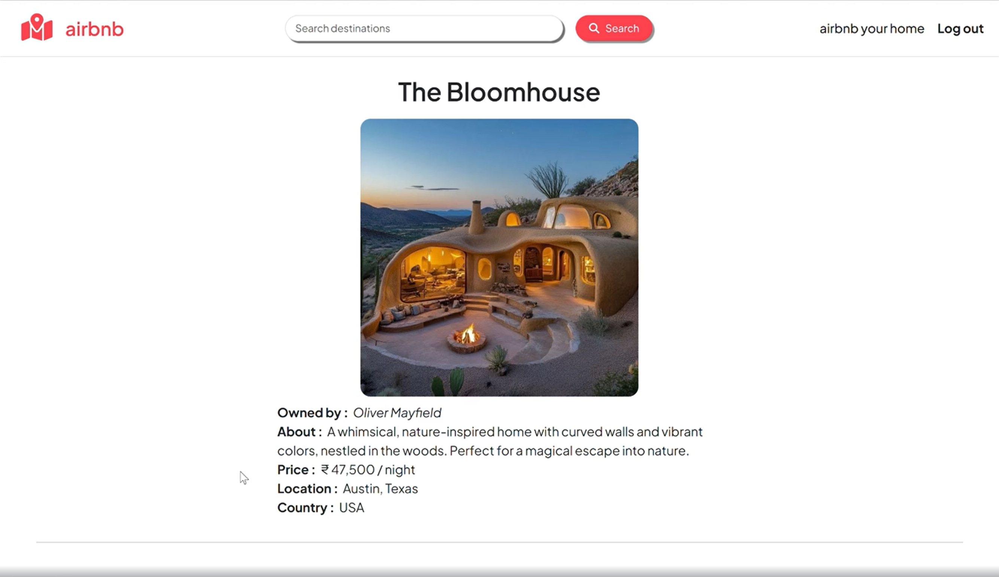

# Airbnb Clone

A full-stack property listing web application inspired by Airbnb, built using Node.js, Express.js, EJS, and MongoDB. The application allows users to explore property listings, manage their own listings, and share reviews.

## Features

- User registration and login with session-based authentication
- Create, view, update, and delete property listings
- Upload and manage property images using Cloudinary
- Add and manage property reviews and ratings
- Interactive location maps using Mapbox
- Authorization for managing listings and reviews
- Responsive user interface

## Tech Stack

- **Frontend:** EJS, HTML, CSS, Bootstrap
- **Backend:** Node.js, Express.js
- **Database:** MongoDB, Mongoose
- **Authentication:** Passport.js, Express Session
- **Image Storage:** Cloudinary, Multer
- **Maps:** Mapbox

## Screenshots

### Homepage


### Property Details


## Getting Started

Clone the repository and navigate to the project directory.

Install the required dependencies:

```bash
npm install
```

Configure the required environment variables for MongoDB, Cloudinary, Mapbox, and session management.

Start the application using the script configured in `package.json`.
